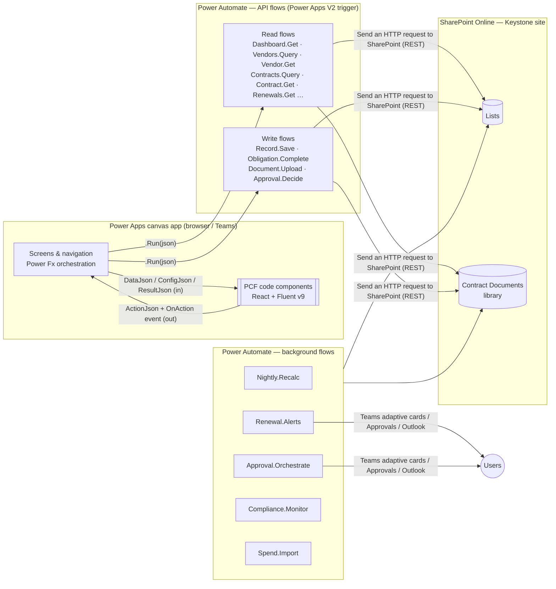
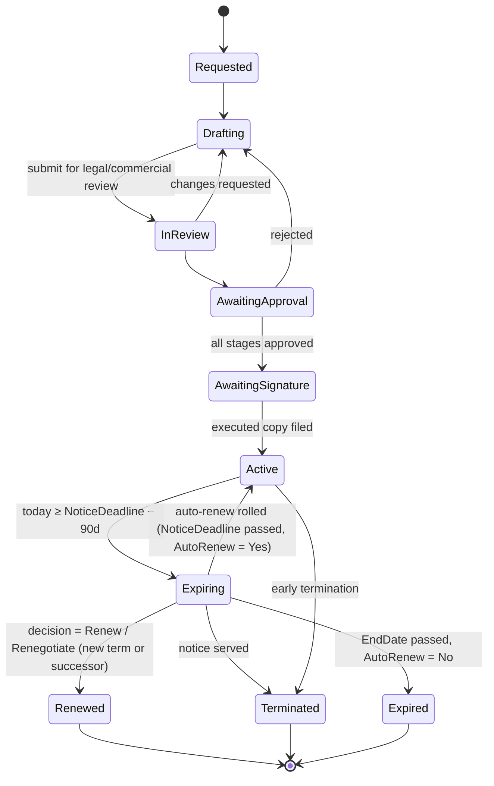

# Keystone — Vendor & Contract Management (PCF solution design)

> Status: **Design v0.1 — for review** · Companion prototype: [`keystone-vcm-pcf.html`](./keystone-vcm-pcf.html) (open in a browser and click **PCF controls** to see each control's boundary and the flow that feeds it).

---

## 1. Summary

Keystone is a premium vendor and contract lifecycle management (CLM) app. It runs as a **Power Apps canvas app** whose screens are built from a set of **PCF code components**. Data lives in **SharePoint Online**, and **Power Automate flows** are the only path to read or write it.

| Goal | What it means in the design |
|---|---|
| Never miss a notice deadline | Notice deadline is a first-class, stored, indexed date. Alerts fire on that date, not the end date. A renewal timeline is the hero view. |
| One view of each supplier | The Vendor 360 screen shows contracts, spend, performance, risk, compliance, documents and activity, all loaded by one flow call. |
| Controlled, auditable change | All writes go through one Save API: role check, field whitelist, optimistic concurrency, audit row. |
| High-end UX on low-code foundations | 12 reusable PCFs (React + Fluent UI v9, virtual controls). A shared design-token package. Skeleton loading, optimistic updates, keyboard-first. |
| Standard-licence friendly | SharePoint + Power Automate standard connectors only. PCFs never call external services directly (see §11). |

**Out of scope for v1:** e-sourcing/tendering, PO/invoice matching (we import spend, we don't run P2P), AI clause extraction (a candidate for phase 4).

---

## 2. Architecture



### 2.1 Key design decisions

| # | Decision | Why | Alternatives rejected |
|---|---|---|---|
| D1 | **The canvas app orchestrates and PCFs only present.** PCFs receive JSON strings through input properties and emit typed `ActionJson` through an output property and the `OnAction` event. The canvas app calls the flows. | PCFs in canvas apps can't call flows themselves. Keeping PCFs free of data access keeps them reusable, testable in Storybook, and outside the premium "connects to external services" classification. | PCF calling an HTTP-trigger flow with `fetch`: exposes a SAS URL or needs token handling, and makes PCFs premium. |
| D2 | **Raw JSON passes straight through.** Flow → `payload` text → variable → PCF `DataJson`. Power Fx never parses list payloads; it only reads small action envelopes. | Avoids slow `ParseJSON`/`ForAll` shaping and delegation issues in Power Fx. One contract shared by flow and PCF. | Collections + PCF dataset properties: forces data through Power Fx shaping and the SharePoint connector. |
| D3 | **APIs are coarse-grained, one call per screen region** (e.g. `Vendor.Get` returns the whole 360 bundle). | Flow latency (~1–3 s per call) dominates. Fewer, richer calls give a faster perceived load. | One flow per list: chatty, so screens wait on 6–8 sequential calls. |
| D4 | **Reads and writes use SharePoint REST, not "Get items".** | `$select`/`$filter`/`$expand`/`$top` and `odata=nometadata` give payloads 5–10× smaller and quicker. Supports ETag concurrency. | "Get items": returns every column plus metadata, with weak filtering. |
| D5 | **Flows run under a service-account connection, with roles enforced inside the flow.** Business users get **read-only (or no) direct access** to the lists. | Stops users editing contracts in the SharePoint UI and bypassing validation and audit. Lets us enforce field-level rules. | Invoker connections: every user needs Contribute on the lists. |
| D6 | **Derived values (status, notice deadline, risk score, rollups) are stored, not calculated columns.** Background flows maintain them. | SharePoint calculated columns can't be filtered or indexed reliably in REST, and don't update with "today". | Calculated columns; computing in the client. |
| D7 | **The dashboard reads a nightly KPI snapshot.** | The dashboard opens in <2 s whatever the portfolio size. It also gives a trend history for sparklines and deltas. | Aggregating 5k+ items per open. |
| D8 | **Fewer, configurable PCFs.** One grid, one chart, one form engine and one record header, all driven by `ConfigJson`. | 12 controls cover every screen, with less to build, test and version. | One PCF per screen. |

---

## 3. SharePoint information architecture

Site: `/sites/Keystone` (dedicated site, unique permissions, no member Contribute). All internal names are PascalCase, with no spaces. **Bold columns are indexed.** Every list keeps its 1–2 most selective filter columns indexed, to stay safe past the 5,000-item view threshold.

### 3.1 Core lists

**Vendors**
| Column | Type | Notes |
|---|---|---|
| Title | Text | Legal name |
| **VendorRef** | Text (unique) | `VND-00042`, set by Save flow |
| TradingName, CompanyNumber, VATNumber, DUNS | Text | |
| **Status** | Choice | Prospect · Onboarding · Active · Under review · Suspended · Exited |
| **Tier** | Choice | Strategic · Critical · Preferred · Approved · Tactical |
| Category | Lookup → Categories | |
| **Owner** | Person | Relationship owner |
| BusinessUnits | Lookup (multi) → BusinessUnits | |
| Country, Currency, Website, Address | Text / Choice | |
| IsDataProcessor | Yes/No | Drives DPA and DPO approval |
| **RiskScore** | Number 0–100 | Maintained by Nightly.Recalc |
| RiskRating | Choice | Low · Medium · High · Critical |
| AnnualSpend | Currency | Rolling 12-month rollup |
| ScorecardScore | Number 0–100 | Latest period |
| **NextReviewDate** | Date | |
| DueDiligenceStatus | Choice | Not started · In progress · Passed · Conditional · Failed |
| SanctionsCheckedOn | Date | |
| ActiveContractCount, TotalContractValue | Number / Currency | Rollups |

**Contracts**
| Column | Type | Notes |
|---|---|---|
| Title | Text | |
| **ContractRef** | Text (unique) | `CON-2026-0142` |
| **Vendor** | Lookup → Vendors | |
| ParentContract | Lookup → Contracts | Builds MSA → SOW → Change Order hierarchy |
| ContractType | Choice | MSA · SOW · Services · Licence · NDA · DPA · Lease · Framework call-off · Change order |
| **Status** | Choice | See state machine §8.1 |
| **Owner** | Person | |
| BusinessUnit, CostCentre | Lookup / Text | |
| StartDate, **EndDate** | Date | |
| NoticePeriodDays | Number | |
| **NoticeDeadline** | Date | `EndDate − NoticePeriodDays`, written by flow |
| AutoRenew, RenewalTermMonths | Yes/No, Number | |
| TCV, ACV | Currency | Total / annualised contract value |
| Currency | Choice | GBP default |
| PaymentTerms, GoverningLaw | Choice | |
| LiabilityCap, TerminationForConvenience | Currency / Yes/No | Key terms |
| IsConfidential | Yes/No | Row-level restriction (§9) |
| RenewalDecision | Choice | Pending · Renew · Renegotiate · Re-tender · Terminate |
| DocumentFolderUrl | Hyperlink | Document set in Contract Documents |
| SignedOn, SignatureStatus | Date / Choice | |
| ETagVersion | (system `owshiddenversion`) | Used for concurrency |

**Obligations** — Contract (lookup, **indexed**), Vendor (lookup), Title, ObligationType (Deliverable · SLA · Payment · Reporting · Compliance · Audit right · Insurance), **Owner**, **DueDate**, Recurrence (None · Monthly · Quarterly · Annually), **Status** (Open · Due soon · Overdue · Met · Breached · Waived), EvidenceUrl, CompletedOn, CompletedBy.

**Contract Documents** (document library, one **document set per contract**) — Contract (lookup), DocType (Executed agreement · Draft · Schedule · Amendment · DPA · Certificate · Correspondence), IsExecuted, VersionLabel. Major versioning on.

**Risks** — Vendor, Contract (optional), Category (Financial · Cyber · Operational · Compliance · ESG · Concentration · Exit), Likelihood (1–5), Impact (1–5), Score (stored L×I), Mitigation, Owner, **Status** (Open · Mitigating · Accepted · Closed), ReviewDate.

**Certificates** — Vendor, CertType (ISO 27001 · ISO 9001 · Cyber Essentials Plus · SOC 2 Type II · Public liability · Professional indemnity · Employer's liability), Reference, **ExpiryDate**, DocumentUrl, Status (Valid · Expiring · Expired · Missing).

**Scorecards** — Vendor, Contract (optional), **Period** (`2026-Q3`), Quality, Delivery, Commercial, Relationship, Innovation (0–100), Overall (weighted), Comments, AssessedBy.

**SpendMonthly** — Vendor, Contract, **PeriodMonth** (date, first of month), Amount, Currency, Source (ERP import / manual). *Monthly aggregates only, never invoice lines.* That's ~12 rows per contract per year, so it stays well inside thresholds. Archive years older than 5 to SpendArchive.

**Approvals** — Contract, Stage (Sequence), Role, Approver (person), Decision (Pending · Approved · Rejected · Delegated), Comments, DecidedOn, ApprovalRunId.

**Activity** (audit + notes) — **EntityType**, **EntityId**, ActionType (Created · Updated · StatusChanged · Note · Call · Meeting · Document · Approval), Summary, DiffJson (multi-line), Actor (person), **Created**. Written by API flows. Users never write here directly.

### 3.2 Reference and configuration lists
- **Categories**: hierarchical (Parent lookup): IT › Cloud, Facilities › FM, etc.
- **BusinessUnits**: name, head (person), finance partner (person).
- **RoleAssignments**: User (person), Role (choice), Scope (BU lookup, optional). Read by every API flow.
- **AppConfig**: Key / Value (JSON). Notice alert offsets `[120,90,60,30,7]`, risk weights, approval matrix, grid column sets, saved views, form schemas (`form.contract.intake`), feature flags.
- **KpiSnapshots**: SnapshotDate, Scope (portfolio / BU), PayloadJson. Written nightly, read by Dashboard.Get.
- **SavedViews**: Owner, Grid, Name, StateJson (filters, sort, columns), IsShared.

### 3.3 Environment variables (solution)
`kst_SiteUrl`, `kst_ListIds` (JSON of list GUIDs, so flows survive list renames), `kst_ServiceMailbox`, `kst_TeamsChannelId`, `kst_FeatureFlags`.

---

## 4. Flow API layer

### 4.1 Standard request/response contract
Every API flow has a **Power Apps (V2)** trigger with a single text input `request` (JSON) and a **Respond to a Power App or flow** step with a single text output `payload` (JSON).

```jsonc
// request
{ "op": "contracts.query", "v": 1, "correlationId": "7f1c…",
  "filter": { "status": ["Active","Expiring"], "ownerMe": false, "search": "cloud" },
  "sort": [{ "field": "noticeDeadline", "dir": "asc" }],
  "page": { "size": 50, "token": null },
  "expectedVersion": null }

// payload (success)
{ "ok": true, "v": 1, "correlationId": "7f1c…", "generatedUtc": "2026-11-01T09:14:03Z",
  "data": { "rows": [ … ], "facets": { "status": { "Active": 182, "Expiring": 17 } } },
  "page": { "nextToken": "Paged=TRUE&p_ID=1450", "total": 214 },
  "user": { "roles": ["ProcurementManager"], "can": { "edit": true, "approve": false } } }

// payload (failure)
{ "ok": false, "correlationId": "7f1c…",
  "error": { "code": "CONFLICT", "message": "This contract was changed by Sam Patel at 09:12.", "retryable": false } }
```

Error codes: `VALIDATION`, `FORBIDDEN`, `NOT_FOUND`, `CONFLICT` (ETag 412), `THROTTLED` (429, retryable), `UPSTREAM`, `UNKNOWN`.

**Flow skeleton (every API flow):**
1. Trigger → `Compose: req = json(triggerBody()['text'])`.
2. **Scope: Authorise.** Get the caller (`triggerOutputs()?['headers']?['x-ms-user-email']`), look up RoleAssignments, compose `can`.
3. **Scope: Try.** Run REST calls in parallel branches, then `Select` into a lean shape.
4. **Scope: Catch** (run after: failed / timed out). Map the error to a code, write the Activity row with `ActionType=Error`, return `ok:false`.
5. Respond with `payload`.

### 4.2 Flow catalogue

| Flow | Type | Feeds / triggered by | Notes |
|---|---|---|---|
| `Keystone · Dashboard.Get` | API read | KPI Strip, Renewal Timeline, Chart, Risk Matrix, Obligation Tracker | Reads today's KpiSnapshot + live "my actions" (obligations & approvals for caller) |
| `Keystone · Vendors.Query` | API read | Data Grid (vendors) | Filter/sort/page via REST; facets for filter chips |
| `Keystone · Vendor.Get` | API read | Vendor 360 (Header, KPIs, Tree, Scorecard chart, Risk, Certificates, Activity) | Parallel branches over 7 lists, one payload |
| `Keystone · Contracts.Query` | API read | Data Grid (contracts) | Grouping by status computed server-side |
| `Keystone · Contract.Get` | API read | Contract screen (Header, Stepper, Form, Obligations, Documents, Approvals, Activity) | Includes `etag` for concurrency |
| `Keystone · Renewals.Get` | API read | Renewal Timeline, decision grid | Contracts where `NoticeDeadline` within horizon |
| `Keystone · Search.Index` | API read | Command Search | Compact `[ref, name, type, id]` index, cached in app for the session |
| `Keystone · Lookups.Get` | API read | Smart Form | Categories, BUs, users-in-role, choice values; cached on start |
| `Keystone · Record.Save` | API write | Smart Form, inline grid edits, header quick actions | Entity + field whitelist per role from AppConfig. ETag `IF-MATCH`. Activity diff. Returns fresh record |
| `Keystone · Obligation.Complete` | API write | Obligation Tracker | Marks met, attaches evidence, spawns next occurrence if recurring |
| `Keystone · Document.Upload` | API write | Document Panel | Base64 in, writes into contract document set, sets metadata. Cap 20 MB |
| `Keystone · Approval.Decide` | API write | Approval Panel | Records the decision. Signals orchestrator via Approvals connector response |
| `Keystone · Approval.Orchestrate` | Automated | Contract → Status = Awaiting approval | Builds route from approval matrix (§8.3). Sequential Approvals, Teams card. Re-arms itself before the 30-day flow limit |
| `Keystone · Nightly.Recalc` | Scheduled 02:00 | — | Statuses, NoticeDeadline, rollups, risk scores, certificate status, KpiSnapshot |
| `Keystone · Renewal.Alerts` | Scheduled 07:30 | — | Alerts owner at notice offsets. Escalates to BU head at ≤30 days with no decision |
| `Keystone · Compliance.Monitor` | Scheduled weekly | — | Certificates expiring ≤45 days, overdue vendor reviews, missing DPAs for data processors |
| `Keystone · Spend.Import` | Automated | File dropped in `/Imports/Spend` | Parses ERP CSV, aggregates to SpendMonthly, flags off-contract spend |
| `Keystone · Contract.Provision` | Child flow | Record.Save (create contract) | Allocates ContractRef, creates document set, seeds standard obligations by contract type |

### 4.3 Concurrency, idempotency and throttling
- **Optimistic concurrency.** `Contract.Get` returns `etag`, and the PCF sends it back as `expectedVersion`. Save uses `X-HTTP-Method: MERGE` + `IF-MATCH: <etag>`. A 412 returns a `CONFLICT` with who changed it and when. The form offers *Reload* or *Review differences*.
- **Idempotency.** Each `ActionJson` carries an `actionId` (GUID). Record.Save writes it to the Activity row, and a repeat `actionId` within 10 minutes returns the original result. This protects against double-clicks and retries.
- **Throttling.** REST calls use the flow's exponential retry policy. Background flows page in batches of 100 and use `$batch` for bulk updates.

---

## 5. PCF catalogue

All controls are **virtual React controls** (`control-type="virtual"`). They use the platform-provided React 16.14 and Fluent UI v9 (`<platform-library>`), so each bundle stays small and theming is shared. Each one depends on the shared package `@keystone/core` (§12).

### 5.1 Common property contract (every control)

| Property | Dir | Type | Purpose |
|---|---|---|---|
| `DataJson` | in | Multiple lines of text | Flow `payload` (or its `data` slice) |
| `ConfigJson` | in | Multiple lines of text | Columns, labels, modes, thresholds. Usually an AppConfig value |
| `ResultJson` | in | Multiple lines of text | Outcome of the last action (`{actionId, ok, data, error}`), used to confirm or roll back optimistic updates |
| `IsLoading` | in | Two options | Shows skeleton state |
| `ThemeJson` | in | Multiple lines of text | Brand tokens. Defaults to Keystone theme |
| `Locale` / `Currency` | in | Single line | `en-GB` / `GBP` defaults |
| `ActionJson` | out | Multiple lines of text | `{actionId, type, entity, id, payload, nonce}` |
| `OnAction` | event | — | Raised after `ActionJson` changes. The canvas app handles it in Power Fx |
| `SelectedId` | out | Single line | Convenience output for simple bindings |

> `nonce` guarantees that two identical actions in a row (e.g. clicking *Refresh* twice) both change the output and both fire.

### 5.2 The 12 controls

| # | Control | Kind | What it does | Main actions emitted | Used on |
|---|---|---|---|---|---|
| 1 | **KPI Strip** `kst.KpiStrip` | Foundation | 3–7 tiles: value, unit, delta vs prior snapshot, sparkline, RAG state, tooltip with definition | `drill` (tile key) | Dashboard, Vendors, Vendor 360, Renewals |
| 2 | **Smart Data Grid** `kst.DataGrid` | Foundation | Virtualised grid (10k rows smooth). Column types: text, link, avatar, badge, currency, date, countdown, progress, risk-ring, icon-set, sparkline. Saved views, facet chips, grouping, multi-select + bulk actions, inline edit (whitelisted cols), CSV export, column chooser, sticky header | `open`, `query` (filter/sort/page), `bulk`, `inlineSave`, `saveView`, `export` | Vendors, Contracts, Renewal decisions, Obligations (full) |
| 3 | **Record Header** `kst.RecordHeader` | Foundation | Hero header for vendor or contract: identity, status, key facts, risk ring or notice countdown, quick-action menu filtered by `user.can` | `command` (renew, amend, terminate, raiseRisk…), `edit` | Vendor 360, Contract |
| 4 | **Smart Form** `kst.SmartForm` | Foundation | Schema-driven forms and wizards. Sections, steps, 18 field types, conditional visibility, cross-field validation, dirty tracking, read/edit modes, autosave draft, live approval-route preview | `save`, `saveDraft`, `stepChange`, `cancel` | Contract intake, Vendor onboarding, Key terms (read mode), Risk & Scorecard entry |
| 5 | **Insight Chart** `kst.Chart` | Foundation | One SVG chart engine: bar (h/v, stacked), line/area, donut, radar (scorecards), bullet (target vs actual), treemap (spend by category). Accessible data-table fallback | `drill` (series, point) | Dashboard, Vendor 360, Contracts |
| 6 | **Renewal Timeline** `kst.RenewalTimeline` | Domain | Gantt of contract terms on a 6/12/24-month axis. Shaded notice window, notice-deadline diamond, auto-renew glyph, today line, value-weighted bar thickness (optional), group by owner/BU/vendor | `open`, `decide` (opens decision), `zoom` | Dashboard, Renewals, Vendor 360 |
| 7 | **Lifecycle Stepper** `kst.LifecycleStepper` | Domain | Contract state machine as a stepper: date entered, days in stage vs SLA, blocked reasons, branch end-states (Renewed / Terminated / Expired) | `stage` (requested transition) | Contract |
| 8 | **Obligation Tracker** `kst.ObligationTracker` | Domain | Obligations bucketed Overdue / ≤7 days / ≤30 days / Later. One-click complete with evidence. Recurrence badge. Owner filter | `complete` (optimistic), `open`, `reassign` | Dashboard ("Action needed"), Contract, Vendor 360 |
| 9 | **Risk Matrix** `kst.RiskMatrix` | Domain | 5×5 likelihood × impact heatmap. Cell counts, click to filter, residual vs inherent toggle, plus vendor-mode list of top risks | `filter` (cell), `open` | Dashboard, Vendor 360 |
| 10 | **Contract Hierarchy** `kst.ContractTree` | Domain | MSA → SOW → Change orders tree with value rollups, status chips, end-date and drift warnings (child ends after parent) | `open` | Vendor 360, Contract |
| 11 | **Approval Panel** `kst.ApprovalPanel` | Collaboration | Visual route (sequential/parallel stages), who/when/comments, approve / reject / delegate with mandatory comment rules | `decide` | Contract, Dashboard (my approvals) |
| 12 | **Activity & Documents** `kst.ActivityHub` | Collaboration | Two tabs. **Activity**: unified timeline (audit diffs, notes, calls, approvals) with a composer. **Documents**: document set with versions, executed flag, drag-and-drop upload (base64 → action), preview/open | `note`, `upload`, `openDoc` | Contract, Vendor 360 |

**Optional (phase 3):** `kst.CommandSearch` is a Ctrl + K palette over the cached `Search.Index` with fuzzy match, recent items and quick commands ("New contract for Orrin…").

### 5.3 Deliberately *not* PCFs
- **App header, nav rail, screen pivots.** Canvas app components are simpler, theme-aware, and need no packaging.
- **Dialogs and toasts.** Canvas app containers, so focus management stays with the host.
- **Notifications.** Teams adaptive cards and Outlook, sent by flows.

### 5.4 Example manifest (Smart Data Grid)
```xml
<manifest>
  <control namespace="Keystone" constructor="DataGrid" version="1.0.0"
           display-name-key="Keystone Smart Data Grid" control-type="virtual">
    <external-service-usage enabled="false"/>
    <property name="DataJson"   of-type="Multiple" usage="input"  required="true"/>
    <property name="ConfigJson" of-type="Multiple" usage="input"  required="true"/>
    <property name="ResultJson" of-type="Multiple" usage="input"/>
    <property name="IsLoading"  of-type="TwoOptions" usage="input"/>
    <property name="ThemeJson"  of-type="Multiple" usage="input"/>
    <property name="Locale"     of-type="SingleLine.Text" usage="input" default-value="en-GB"/>
    <property name="ActionJson" of-type="Multiple" usage="output"/>
    <property name="SelectedId" of-type="SingleLine.Text" usage="output"/>
    <event name="OnAction" display-name-key="OnAction"/>
    <resources>
      <code path="index.ts" order="1"/>
      <platform-library name="React"  version="16.14.0"/>
      <platform-library name="Fluent" version="9.46.2"/>
    </resources>
  </control>
</manifest>
```

---

## 6. Canvas ↔ PCF ↔ Flow integration

```powerfx
// scrContract.OnVisible — load everything for the screen in parallel
Set(locLoading, true);
Concurrent(
    Set(locContract, KeystoneContractGet.Run(JSON({op:"contract.get", v:1, id:gblContractId})).payload),
    Set(locActivity, KeystoneActivityQuery.Run(JSON({op:"activity.query", v:1, entity:"contract", id:gblContractId, top:50})).payload)
);
Set(locLoading, false);

// kstObligations.DataJson  -> locContract          (control picks its slice via ConfigJson.path = "data.obligations")
// kstObligations.ResultJson -> locLastResult
// kstObligations.OnAction:
With({a: ParseJSON(Self.ActionJson)},
    Switch(Text(a.type),
        "complete", Set(locLastResult, KeystoneObligationComplete.Run(Self.ActionJson).payload),
        "open",     Set(gblContractId, Text(a.id)); Navigate(scrContract, ScreenTransition.None),
        "refresh",  Select(btnReload)
    )
)
```

**Optimistic update loop:** the PCF ticks the obligation immediately and emits `complete` with an `actionId`. The canvas app runs the flow and pipes the `payload` into `ResultJson`. The PCF matches the `actionId`, then either confirms or reverts and shows the error inline.

**Caching:** `Lookups.Get` and `Search.Index` load once in `App.OnStart` (inside `Concurrent`) and are held in global variables. Screen payloads are kept per record id, so going back to a screen shows the cached data at once, then refreshes in the background (stale-while-revalidate).

---

## 7. Screens

| # | Screen | Layout & PCFs | Data |
|---|---|---|---|
| 01 | **Portfolio** | KPI Strip · Renewal Timeline (12 m) · Obligation Tracker "Action needed" + Approval Panel (mine) · Chart (spend by category) · Risk Matrix · Chart (contracts by status) | Dashboard.Get |
| 02 | **Vendors** | KPI Strip · Smart Data Grid (saved views: All active, Strategic & critical, High risk, Reviews due, Data processors) | Vendors.Query |
| 03 | **Vendor 360** | Record Header · KPI Strip · pivots: Overview (Contract Hierarchy, Chart radar/bars scorecard, Certificates, Risk Matrix-list, Activity) · Contracts · Performance · Risk & compliance · Documents | Vendor.Get |
| 04 | **Contracts** | Facet chips · Smart Data Grid grouped by status with countdown column | Contracts.Query |
| 05 | **Contract** | Record Header (notice countdown) · Lifecycle Stepper · Smart Form (key terms, read mode) · Obligation Tracker · Contract Hierarchy · Approval Panel · Activity & Documents | Contract.Get |
| 06 | **Renewals** | KPI Strip · Renewal Timeline (zoomable, grouped) · Smart Data Grid (decision queue, inline decision) | Renewals.Get |
| 07 | **New contract** | Smart Form wizard: Basics → Vendor → Commercials → Risk & data → Documents → Review. Side panel shows live approval route + validation summary | Lookups.Get → Record.Save |

Responsive: designed for 1366–1920 px desktop and Teams tab. At ≤1280 px, two-column regions stack. Phone layout is out of scope for v1 (read-only approval via Teams card covers mobile).

---

## 8. Business rules

### 8.1 Contract state machine

Transitions are only requested by the Lifecycle Stepper (`stage` action) and checked in Record.Save (allowed transitions + role). Time-based transitions are applied by Nightly.Recalc.

### 8.2 Renewal and notice rules
- `NoticeDeadline = EndDate − NoticePeriodDays`. This is the controlling date. **Alerts key off it, not EndDate.**
- Alerts go to the owner at `[120, 90, 60, 30, 7]` days before NoticeDeadline (configurable). At ≤30 days with `RenewalDecision = Pending`, the alert escalates to the BU head and procurement.
- Auto-renew contracts that pass NoticeDeadline undecided roll forward by `RenewalTermMonths`. They are flagged **"rolled without decision"** for the KPI and audit.

### 8.3 Approval matrix (AppConfig `approval.matrix`)
| Condition | Route |
|---|---|
| TCV < £50k | Contract owner's BU head |
| £50k ≤ TCV < £250k | BU head → Finance business partner |
| £250k ≤ TCV < £1m | BU head → Finance → Legal |
| TCV ≥ £1m | BU head → Finance → Legal → CFO |
| Vendor `IsDataProcessor` = Yes | + DPO (parallel with Legal) |
| Vendor RiskRating ≥ High | + Head of Risk (parallel with Finance) |

### 8.4 Vendor risk score (0–100, higher = riskier)
Weighted sum of normalised factors. The weights live in AppConfig.
| Factor | Weight | Source |
|---|---|---|
| Cyber / information security | 25% | Certificates (ISO 27001/CE+/SOC2), open Cyber risks |
| Financial health | 20% | Due diligence rating, credit check input |
| Concentration / dependency | 15% | Vendor share of category spend, single-source flag, tier |
| Compliance | 15% | Expired/missing certificates, overdue reviews, sanctions recency |
| Performance | 15% | 100 − latest scorecard |
| Data protection | 10% | Data processor without signed DPA ⇒ max |

Rating bands: 0–39 Low · 40–59 Medium · 60–79 High · 80+ Critical.

---

## 9. Security and roles

| Capability | Viewer | Contract owner | Procurement | Legal | Finance | Admin |
|---|:-:|:-:|:-:|:-:|:-:|:-:|
| View non-confidential vendors & contracts | ✓ | ✓ | ✓ | ✓ | ✓ | ✓ |
| View confidential contracts | | own | ✓ | ✓ | ✓ | ✓ |
| Create contract request | | ✓ | ✓ | ✓ | | ✓ |
| Edit commercial terms | | own (draft) | ✓ | | ✓ | ✓ |
| Edit legal terms | | | | ✓ | | ✓ |
| Complete obligations | | own | ✓ | ✓ | ✓ | ✓ |
| Approve | per route | per route | per route | per route | per route | |
| Manage vendors / tiering | | | ✓ | | | ✓ |
| Configuration (AppConfig, roles) | | | | | | ✓ |

- **Enforced in flows** (RoleAssignments + whitelist). The UI also hides actions using `user.can`, but that's for convenience, not security.
- **SharePoint:** members get **Read** on reference lists only. Core lists are readable by the service account + Keystone Admins. Contract Documents uses unique permissions per confidential document set. Everyone else reaches documents only through the app.
- **Service account:** licensed, MFA via conditional access, connection reference owned by the platform team. DLP policy keeps SharePoint, Approvals, Teams and Office 365 Outlook in the Business group.
- **Audit:** Activity list (app-level, with diffs) plus SharePoint version history. Retention label on Contracts and Contract Documents (e.g. 7 years after EndDate).

---

## 10. Performance and scale targets

| Metric | Target | How |
|---|---|---|
| Dashboard first meaningful paint | < 2.5 s | KpiSnapshot (1 item read) + skeleton PCFs render instantly |
| Vendor 360 / Contract load | < 3 s | Single bundled flow with parallel branches. Cached revisit shows instantly |
| Grid paging | < 1.5 s per page | Indexed `$filter`, `$top=50`, server facets |
| Payload size | < 500 KB typical, < 2 MB max | `$select`, short keys, no HTML, page tokens |
| Volume | 2k vendors · 10k contracts · 50k obligations · 500k activity rows | Indexed columns, monthly spend aggregation, activity filtered by EntityId + date |

---

## 11. Platform, licensing and ALM

- **Licensing intent:** SharePoint, Approvals, Teams and Outlook connectors are standard. The PCFs declare `external-service-usage enabled="false"` and get all data through the host app, so the app is designed to run on Microsoft 365-seeded Power Apps/Power Automate rights. *Validate with your licensing contact.* E-signature connectors (DocuSign / Adobe Sign) are premium and listed as an optional integration.
- **Environment:** solution-aware canvas app. The tenant/environment setting **"Allow publishing of canvas apps with code components"** must be on.
- **Solution contents:** canvas app, 12 PCFs, flows, connection references (SharePoint, Approvals, Teams, Outlook), environment variables.
- **Pipelines:** Dev → Test → Prod with Power Platform Pipelines, or GitHub Actions using `pac` CLI (`pac pcf push` in dev, managed solution export/import downstream). PCF versions bump on every release, otherwise canvas apps won't pick up the update.

---

## 12. Engineering

```
keystone-vcm/
├─ packages/
│  └─ core/                 # @keystone/core — tokens, theme, formatters (Intl), JSON contract types (zod),
│                           #   action emitter, skeletons, icons, a11y helpers, test fixtures
├─ controls/
│  ├─ KpiStrip/  DataGrid/  RecordHeader/  SmartForm/  Chart/
│  ├─ RenewalTimeline/  LifecycleStepper/  ObligationTracker/  RiskMatrix/
│  └─ ContractTree/  ApprovalPanel/  ActivityHub/
├─ flows/                   # exported flow definitions + request/response JSON Schemas (source of truth)
├─ solution/                # cdsproj referencing all controls
├─ storybook/               # every control rendered against fixture payloads (incl. empty/error/loading)
└─ .github/workflows/       # lint, test, build, pack solution, deploy
```

- **Stack:** TypeScript (strict), React 16.14 (platform), Fluent UI v9, `@tanstack/react-virtual` (grid), hand-rolled SVG charts (no heavy chart library), `zod` for payload validation in dev builds, `date-fns`.
- **Contract-first:** JSON Schemas in `/flows/schemas` generate TS types used by PCFs, and act as documentation for flow builders.
- **Quality:** Jest + Testing Library (≥80% on core and grid). Storybook visual regression. axe accessibility checks in CI. Bundle budget per control: ≤150 KB gzipped.
- **Accessibility:** WCAG 2.2 AA. ARIA grid pattern with roving tabindex. All charts have a table alternative. Colour is never the only signal (icons + text on RAG). Respects reduced motion. Windows high-contrast via Fluent tokens.
- **Design tokens:** Fluent v9 theme generated from the Keystone brand ramp (navy `#1F3A5F`, accent brass `#A67C3D`). Tabular numerals for money. en-GB dates (`1 Nov 2026`).
- **Telemetry:** canvas `Trace()` to Application Insights, with flow `correlationId` passed through. Flow failures land in the Activity list (`ActionType=Error`) plus an admin Teams channel.

---

## 13. Delivery roadmap

| Phase | Scope | Outcome |
|---|---|---|
| **0 · Foundations** (2 wks) | SharePoint provisioning script (PnP PowerShell), AppConfig, RoleAssignments, `@keystone/core`, API flow template, CI | Skeleton app, one end-to-end read + write |
| **1 · Register** (4 wks) | Data Grid, Record Header, KPI Strip, Smart Form. Vendors / Contracts / Contract screens. Record.Save, Contract.Provision | Usable vendor & contract register replacing spreadsheets |
| **2 · Lifecycle** (4 wks) | Renewal Timeline, Lifecycle Stepper, Obligation Tracker, Approval Panel, Activity & Documents. Nightly.Recalc, Renewal.Alerts, Approval.Orchestrate | No missed notice dates. Governed approvals |
| **3 · Insight** (3 wks) | Chart, Risk Matrix, Contract Tree, Vendor 360, Dashboard, scorecards, Spend.Import, Compliance.Monitor, Command Search | Portfolio and supplier-risk visibility |
| **4 · Extend** (optional) | E-signature, AI key-term extraction from executed PDFs (AI Builder / Azure OpenAI), supplier self-service portal (Power Pages) | — |

---

## 14. Assumptions and open questions
1. **Volumes.** Confirm order of magnitude (contracts, vendors). This drives whether Activity needs yearly partitioning.
2. **Spend source.** Which ERP, and is a monthly CSV export acceptable, or is an API needed?
3. **Document preview.** Embedding SharePoint previews inside a canvas app iframe depends on framing policy. *Spike in phase 0.* The fallback is open in new tab (Office Online / PDF viewer).
4. **Approval matrix & thresholds.** §8.3 is a starting proposal and needs finance and legal sign-off.
5. **Confidential contracts.** Is per-contract confidentiality enough, or are BU-scoped walls needed (supported via RoleAssignments.Scope)?
6. **Service-account model (D5).** Needs approval from the security team.
7. **Mobile.** Is Teams adaptive-card approval enough for v1?
