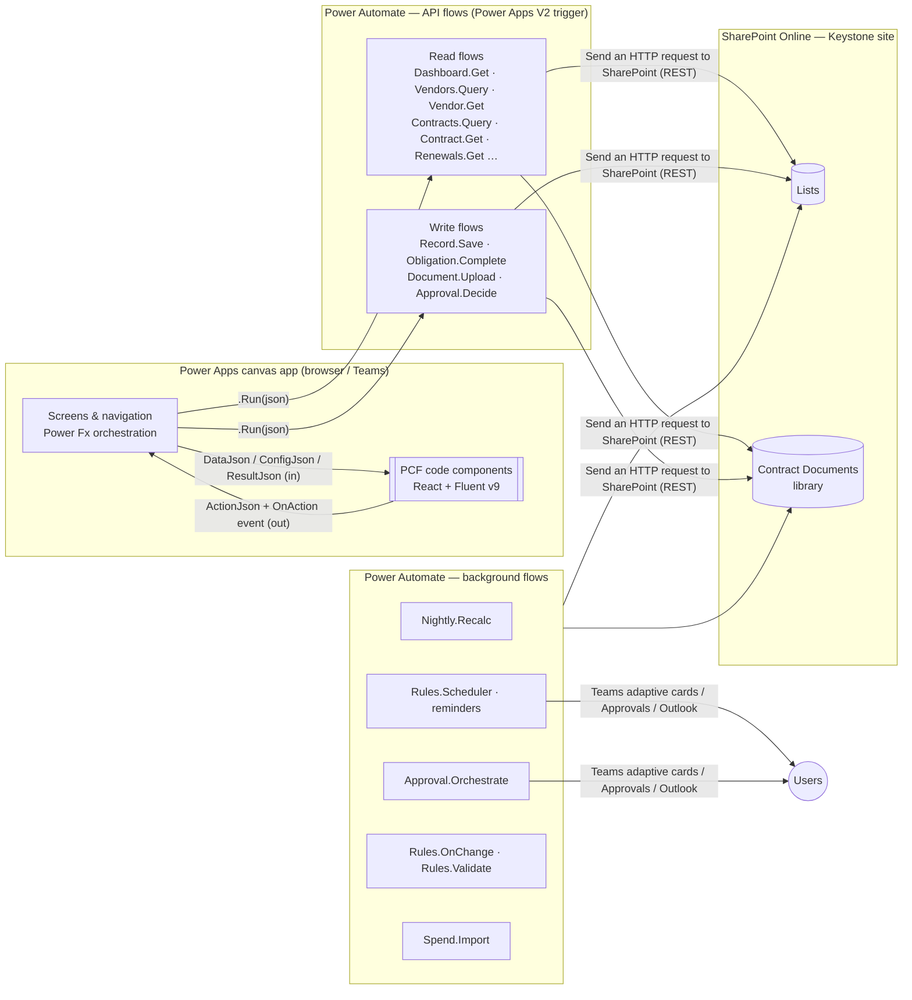
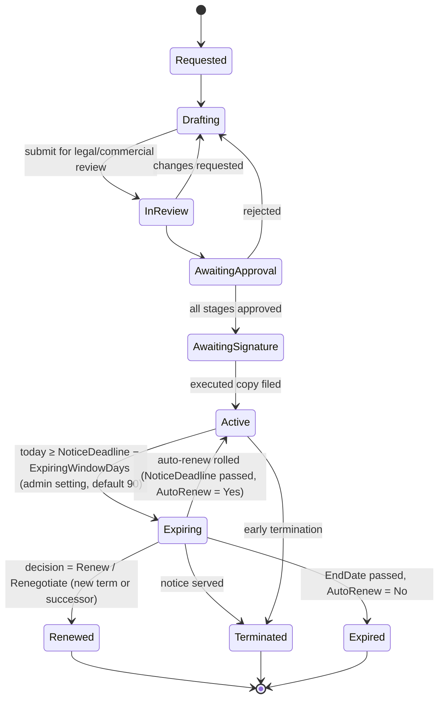
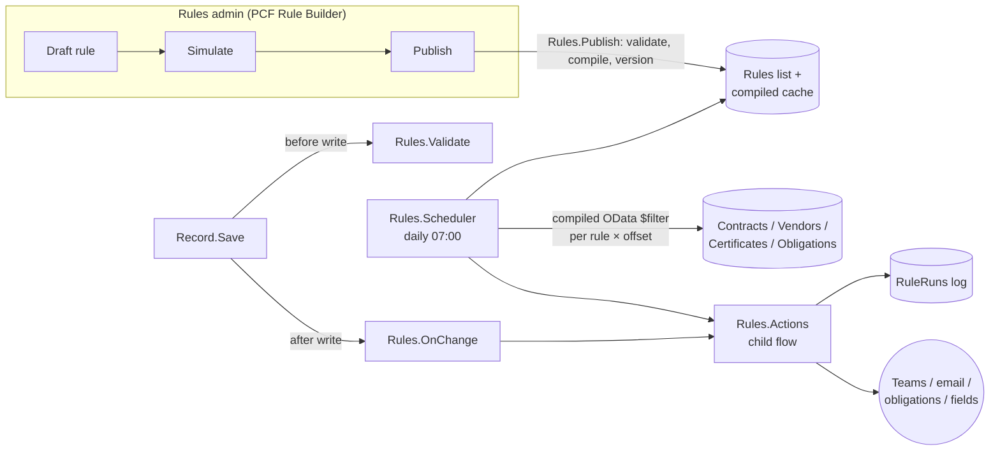

# Keystone — Vendor & Contract Management (PCF solution design)

> Status: **Design v0.1 — for review** · Companion prototype: [`keystone-vcm-pcf.html`](./keystone-vcm-pcf.html) (open in a browser and click **PCF controls** to see each control's boundary and the flow that feeds it).

---

## 1. Summary

Keystone is a premium vendor and contract lifecycle management (CLM) app. It runs as a **Power Apps canvas app** whose screens are built from a set of **PCF code components**. Data lives in **SharePoint Online**, and **Power Automate flows** are the only path to read or write it.

| Goal | What it means in the design |
|---|---|
| Never miss a notice deadline | Notice deadline is a first-class, stored, indexed date. Alerts fire on that date, not the end date. A renewal timeline is the hero view. |
| One view of each supplier | The Vendor 360 screen shows contracts, spend, performance, risk, compliance, documents and activity, all loaded by one flow call. |
| Controlled, auditable change | All writes go through one Save API: role check, field whitelist, optimistic concurrency, audit row. |
| Admin-owned business rules | Reminder schedules, escalations, validations, approval routes and obligation templates are rules that admins build, simulate and publish themselves (§9). |
| High-end UX on low-code foundations | 13 reusable PCFs (React + Fluent UI v9, virtual controls). A shared design-token package. Skeleton loading, optimistic updates, keyboard-first. |
| Standard-licence friendly | SharePoint + Power Automate standard connectors only. PCFs never call external services directly (see §12). |

**Out of scope for v1:** e-sourcing/tendering, PO/invoice matching (we import spend, we don't run P2P), AI clause extraction (a candidate for phase 4).

---

## 2. Architecture



### 2.1 Key design decisions

| # | Decision | Why | Alternatives rejected |
|---|---|---|---|
| D1 | **The canvas app orchestrates and PCFs only present.** PCFs receive JSON strings through input properties and emit typed `ActionJson` through an output property and the `OnAction` event. The canvas app calls the flows. | PCFs in canvas apps can't call flows themselves. Keeping PCFs free of data access keeps them reusable, testable in Storybook, and outside the premium "connects to external services" classification. | PCF calling an HTTP-trigger flow with `fetch`: exposes a SAS URL or needs token handling, and makes PCFs premium. |
| D2 | **Raw JSON passes straight through.** Flow → `payload` text → variable → PCF `DataJson`. Power Fx never parses list payloads; it only reads small action envelopes. | Avoids slow `ParseJSON`/`ForAll` shaping and delegation issues in Power Fx. One contract shared by flow and PCF. | Collections + PCF dataset properties: forces data through Power Fx shaping and the SharePoint connector. |
| D3 | **APIs are coarse-grained, one call per screen region** (e.g. `Vendor.Get` returns the whole 360 bundle). | Flow latency (~1–3 s per call) dominates. Fewer, richer calls give a faster perceived load. | One flow per list: chatty, so screens wait on 6–8 sequential calls. |
| D4 | **Reads and writes use SharePoint REST, not "Get items".** | `$select`/`$filter`/`$expand`/`$top` and `odata=nometadata` give payloads 5–10× smaller and quicker. Supports ETag concurrency. | "Get items": returns every column plus metadata, with weak filtering. |
| D5 | **Flows run under a service-account connection, with roles enforced inside the flow.** Business users get **read-only (or no) direct access** to the lists. | Stops users editing contracts in the SharePoint UI and bypassing validation and audit. Lets us enforce field-level rules. | Invoker connections: every user needs Contribute on the lists. |
| D6 | **Derived values (status, notice deadline, risk score, rollups) are stored, not calculated columns.** Background flows maintain them. | SharePoint calculated columns can't be filtered or indexed reliably in REST, and don't update with "today". | Calculated columns; computing in the client. |
| D7 | **The dashboard reads a nightly KPI snapshot.** | The dashboard opens in <2 s whatever the portfolio size. It also gives a trend history for sparklines and deltas. | Aggregating 5k+ items per open. |
| D9 | **Business rules are data, not flow logic.** Reminders, escalations, validations, approval routing and obligation templates are versioned JSON rules that admins edit in a Rule Builder. Conditions are compiled to SharePoint queries when published. | Admins change reminder times and policy without a developer or release. Rules can be tested by simulation and audited. The scheduler stays simple and fast. | Hard-coded flows per alert type; free-form expressions interpreted at run time. |
| D8 | **Fewer, configurable PCFs.** One grid, one chart, one form engine and one record header, all driven by `ConfigJson`. | 13 controls cover every screen, with less to build, test and version. | One PCF per screen. |

---

## 3. SharePoint information architecture

Site: `/sites/Keystone` (dedicated site, unique permissions, no member Contribute). All internal names are PascalCase, with no spaces. **Bold columns are indexed.** Every list keeps its 1–2 most selective filter columns indexed, to stay safe past the 5,000-item view threshold.

### 3.1 Core lists

**Vendors**
| Column | Type | Notes |
|---|---|---|
| Title | Text | Legal name |
| **VendorRef** | Text (unique) | `VND-00042`, set by Save flow |
| TradingName, CompanyNumber, VATNumber, DUNS | Text | |
| **Status** | Choice | Prospect · Onboarding · Active · Under review · Suspended · Exited |
| **Tier** | Choice | Strategic · Critical · Preferred · Approved · Tactical |
| Category | Lookup → Categories | |
| **Owner** | Person | Relationship owner |
| BusinessUnits | Lookup (multi) → BusinessUnits | |
| Country, Currency, Website, Address | Text / Choice | |
| IsDataProcessor | Yes/No | Drives DPA and DPO approval |
| **RiskScore** | Number 0–100 | Maintained by Nightly.Recalc |
| RiskRating | Choice | Low · Medium · High · Critical |
| AnnualSpend | Currency | Rolling 12-month rollup |
| ScorecardScore | Number 0–100 | Latest period |
| **NextReviewDate** | Date | |
| DueDiligenceStatus | Choice | Not started · In progress · Passed · Conditional · Failed |
| SanctionsCheckedOn | Date | |
| ActiveContractCount, TotalContractValue | Number / Currency | Rollups |

**Contracts**
| Column | Type | Notes |
|---|---|---|
| Title | Text | |
| **ContractRef** | Text (unique) | `CON-2026-0142` |
| **Vendor** | Lookup → Vendors | |
| ParentContract | Lookup → Contracts | Builds MSA → SOW → Change Order hierarchy |
| ContractType | Choice | MSA · SOW · Services · Licence · NDA · DPA · Lease · Framework call-off · Change order |
| **Status** | Choice | See state machine §8.1 |
| **Owner** | Person | |
| BusinessUnit, CostCentre | Lookup / Text | |
| StartDate, **EndDate** | Date | |
| NoticePeriodDays | Number | |
| **NoticeDeadline** | Date | `EndDate − NoticePeriodDays`, written by flow |
| AutoRenew, RenewalTermMonths | Yes/No, Number | |
| TCV, ACV | Currency | Total / annualised contract value |
| Currency | Choice | GBP default |
| PaymentTerms, GoverningLaw | Choice | |
| LiabilityCap, TerminationForConvenience | Currency / Yes/No | Key terms |
| IsConfidential | Yes/No | Row-level restriction (§10) |
| RenewalDecision | Choice | Pending · Renew · Renegotiate · Re-tender · Terminate |
| DocumentFolderUrl | Hyperlink | Document set in Contract Documents |
| SignedOn, SignatureStatus | Date / Choice | |
| ETagVersion | (system `owshiddenversion`) | Used for concurrency |

**Obligations** — Contract (lookup, **indexed**), Vendor (lookup), Title, ObligationType (Deliverable · SLA · Payment · Reporting · Compliance · Audit right · Insurance), **Owner**, **DueDate**, Recurrence (None · Monthly · Quarterly · Annually), **Status** (Open · Due soon · Overdue · Met · Breached · Waived), EvidenceUrl, CompletedOn, CompletedBy.

**Contract Documents** (document library, one **document set per contract**) — Contract (lookup), DocType (Executed agreement · Draft · Schedule · Amendment · DPA · Certificate · Correspondence), IsExecuted, VersionLabel. Major versioning on.

**Risks** — Vendor, Contract (optional), Category (Financial · Cyber · Operational · Compliance · ESG · Concentration · Exit), Likelihood (1–5), Impact (1–5), Score (stored L×I), Mitigation, Owner, **Status** (Open · Mitigating · Accepted · Closed), ReviewDate.

**Certificates** — Vendor, CertType (ISO 27001 · ISO 9001 · Cyber Essentials Plus · SOC 2 Type II · Public liability · Professional indemnity · Employer's liability), Reference, **ExpiryDate**, DocumentUrl, Status (Valid · Expiring · Expired · Missing).

**Scorecards** — Vendor, Contract (optional), **Period** (`2026-Q3`), Quality, Delivery, Commercial, Relationship, Innovation (0–100), Overall (weighted), Comments, AssessedBy.

**SpendMonthly** — Vendor, Contract, **PeriodMonth** (date, first of month), Amount, Currency, Source (ERP import / manual). *Monthly aggregates only, never invoice lines.* That's ~12 rows per contract per year, so it stays well inside thresholds. Archive years older than 5 to SpendArchive.

**Approvals** — Contract, Stage (Sequence), Role, Approver (person), Decision (Pending · Approved · Rejected · Delegated), Comments, DecidedOn, ApprovalRunId.

**Activity** (audit + notes) — **EntityType**, **EntityId**, ActionType (Created · Updated · StatusChanged · Note · Call · Meeting · Document · Approval), Summary, DiffJson (multi-line), Actor (person), **Created**. Written by API flows. Users never write here directly.

### 3.2 Reference and configuration lists
- **Categories**: hierarchical (Parent lookup): IT › Cloud, Facilities › FM, etc.
- **BusinessUnits**: name, head (person), finance partner (person).
- **RoleAssignments**: User (person), Role (choice), Scope (BU lookup, optional). Read by every API flow.
- **AppConfig**: Key / Value (JSON). Settings (Expiring window, risk weights and bands, quiet hours, alert caps), the rules field catalogue, compiled rules cache, grid column sets, saved views, form schemas (`form.contract.intake`), feature flags. Edited through the Rules admin screen, not directly.
- **Rules**: RuleId, Name, Type, Entity, Status (Draft · Testing · Published · Retired), Version, Priority, OverrideKey, IsSystem, IsLocked, DefinitionJson (§9.2), CompiledJson (filters per offset), Owner, PublishedBy, PublishedOn. Earlier versions go to **RuleVersions** (RuleId, Version, DefinitionJson, Diff, PublishedBy).
- **RuleRuns**: RuleId, RuleVersion, **EntityType**, **EntityId**, **IdempotencyKey** (unique), Offset, AnchorDate, Action, Recipients, Outcome (Sent · Suppressed · Failed · Test), **Created**. Rows older than 2 years are archived.
- **RuleOverrides**: RuleId, EntityType, EntityId, Kind (Snooze · AddOffset · Disable), Value, Until, SetBy, Reason.
- **MessageTemplates**: TemplateId, Name, Channel, Subject, Body (with tokens), CardJson (Teams adaptive card), Version.
- **Holidays**: Date, Name, Region. Used for working-day offsets.
- **KpiSnapshots**: SnapshotDate, Scope (portfolio / BU), PayloadJson. Written nightly, read by Dashboard.Get.
- **SavedViews**: Owner, Grid, Name, StateJson (filters, sort, columns), IsShared.

### 3.3 Environment variables (solution)
`kst_SiteUrl`, `kst_ListIds` (JSON of list GUIDs, so flows survive list renames), `kst_ServiceMailbox`, `kst_TeamsChannelId`, `kst_FeatureFlags`, `kst_LicenceKey`.

**Licence key.** A signed JSON token (tenant ID, plan, expiry, signature). The app checks it on start (public key in `@keystone/core`) and the API flows check it too. Enterprise-only features are gated by plan. An expired key never blocks access to data: the app drops to read-only with a renewal banner, and reminders keep running for 30 days.

---

## 4. Flow API layer

### 4.1 Standard request/response contract
Every API flow has a **Power Apps (V2)** trigger with a single text input `request` (JSON) and a **Respond to a Power App or flow** step with a single text output `payload` (JSON).

```jsonc
// request
{ "op": "contracts.query", "v": 1, "correlationId": "7f1c…",
  "filter": { "status": ["Active","Expiring"], "ownerMe": false, "search": "cloud" },
  "sort": [{ "field": "noticeDeadline", "dir": "asc" }],
  "page": { "size": 50, "token": null },
  "expectedVersion": null }

// payload (success)
{ "ok": true, "v": 1, "correlationId": "7f1c…", "generatedUtc": "2026-11-01T09:14:03Z",
  "data": { "rows": [ … ], "facets": { "status": { "Active": 182, "Expiring": 17 } } },
  "page": { "nextToken": "Paged=TRUE&p_ID=1450", "total": 214 },
  "user": { "roles": ["ProcurementManager"], "can": { "edit": true, "approve": false } } }

// payload (failure)
{ "ok": false, "correlationId": "7f1c…",
  "error": { "code": "CONFLICT", "message": "This contract was changed by Sam Patel at 09:12.", "retryable": false } }
```

Error codes: `VALIDATION`, `FORBIDDEN`, `NOT_FOUND`, `CONFLICT` (ETag 412), `THROTTLED` (429, retryable), `UPSTREAM`, `UNKNOWN`.

**Flow skeleton (every API flow):**
1. Trigger → `Compose: req = json(triggerBody()['text'])`.
2. **Scope: Authorise.** Get the caller (`triggerOutputs()?['headers']?['x-ms-user-email']`), look up RoleAssignments, compose `can`.
3. **Scope: Try.** Run REST calls in parallel branches, then `Select` into a lean shape.
4. **Scope: Catch** (run after: failed / timed out). Map the error to a code, write the Activity row with `ActionType=Error`, return `ok:false`.
5. Respond with `payload`.

### 4.2 Flow catalogue

| Flow | Type | Feeds / triggered by | Notes |
|---|---|---|---|
| `Keystone · Dashboard.Get` | API read | KPI Strip, Renewal Timeline, Chart, Risk Matrix, Obligation Tracker | Reads today's KpiSnapshot + live "my actions" (obligations & approvals for caller) |
| `Keystone · Vendors.Query` | API read | Data Grid (vendors) | Filter/sort/page via REST; facets for filter chips |
| `Keystone · Vendor.Get` | API read | Vendor 360 (Header, KPIs, Tree, Scorecard chart, Risk, Certificates, Activity) | Parallel branches over 7 lists, one payload |
| `Keystone · Contracts.Query` | API read | Data Grid (contracts) | Grouping by status computed server-side |
| `Keystone · Contract.Get` | API read | Contract screen (Header, Stepper, Form, Obligations, Documents, Approvals, Activity) | Includes `etag` for concurrency |
| `Keystone · Renewals.Get` | API read | Renewal Timeline, decision grid | Contracts where `NoticeDeadline` within horizon |
| `Keystone · Search.Index` | API read | Command Search | Compact `[ref, name, type, id]` index, cached in app for the session |
| `Keystone · Lookups.Get` | API read | Smart Form | Categories, BUs, users-in-role, choice values; cached on start |
| `Keystone · Record.Save` | API write | Smart Form, inline grid edits, header quick actions | Entity + field whitelist per role from AppConfig. ETag `IF-MATCH`. Activity diff. Returns fresh record |
| `Keystone · Obligation.Complete` | API write | Obligation Tracker | Marks met, attaches evidence, spawns next occurrence if recurring |
| `Keystone · Document.Upload` | API write | Document Panel | Base64 in, writes into contract document set, sets metadata. Cap 20 MB |
| `Keystone · Approval.Decide` | API write | Approval Panel | Records the decision. Signals orchestrator via Approvals connector response |
| `Keystone · Approval.Orchestrate` | Automated | Contract → Status = Awaiting approval | Builds route by evaluating the published **approval routing rules** (§9). Sequential/parallel Approvals, Teams card. Re-arms itself before the 30-day flow limit |
| `Keystone · Nightly.Recalc` | Scheduled 02:00 | — | Statuses, NoticeDeadline, rollups, risk scores, certificate status, KpiSnapshot (uses admin settings) |
| `Keystone · Rules.Scheduler` | Scheduled 07:00 | — | Runs every published reminder rule: compiled query per offset, then dedupe via RuleRuns, then Rules.Actions. Replaces fixed renewal and compliance alert flows |
| `Keystone · Rules.Validate` | Child flow | Record.Save (before write) | Evaluates validation rules against the proposed record. Returns errors and warnings |
| `Keystone · Rules.OnChange` | Child flow | Record.Save (after write) | Evaluates event rules using before/after values (`changed`, `changedTo`) |
| `Keystone · Rules.Actions` | Child flow | Scheduler, OnChange | Runs actions: notify (template render → Teams/email/in-app/digest), set field, create obligation, start approval. Applies caps, quiet hours and test mode |
| `Keystone · Rules.Get` / `Rules.Save` | API | Rule Builder | Rule library, field catalogue, templates. Saves drafts |
| `Keystone · Rules.Simulate` | API | Rule Builder | Matches today + 90-day send forecast. Sends nothing |
| `Keystone · Rules.Publish` | API | Rule Builder | Validates and test-runs compiled filters, versions, diffs to Activity, refreshes cache. Second-publisher approval for routing/validation rules |
| `Keystone · Digest.Send` | Scheduled 08:00 | — | Sends one combined message per person for alerts over the per-day cap or set to digest |
| `Keystone · Spend.Import` | Automated | File dropped in `/Imports/Spend` | Parses ERP CSV, aggregates to SpendMonthly, flags off-contract spend |
| `Keystone · Data.Import` | Automated | Excel template dropped in `/Imports/Data` | Validates and upserts Vendors, Contracts, Obligations, Certificates from the import workbook (matches on Ref). Writes a results file next to the upload. Used at install and for bulk updates |
| `Keystone · Data.Export` | API | Rules admin › Settings | Exports all lists to Excel + a documents zip in `/Exports`, for exit, audit or backup |
| `Keystone · Contract.Provision` | Child flow | Record.Save (create contract) | Allocates ContractRef, creates document set, seeds standard obligations by contract type |

### 4.3 Concurrency, idempotency and throttling
- **Optimistic concurrency.** `Contract.Get` returns `etag`, and the PCF sends it back as `expectedVersion`. Save uses `X-HTTP-Method: MERGE` + `IF-MATCH: <etag>`. A 412 returns a `CONFLICT` with who changed it and when. The form offers *Reload* or *Review differences*.
- **Idempotency.** Each `ActionJson` carries an `actionId` (GUID). Record.Save writes it to the Activity row, and a repeat `actionId` within 10 minutes returns the original result. This protects against double-clicks and retries.
- **Throttling.** REST calls use the flow's exponential retry policy. Background flows page in batches of 100 and use `$batch` for bulk updates.

---

## 5. PCF catalogue

All controls are **virtual React controls** (`control-type="virtual"`). They use the platform-provided React 16.14 and Fluent UI v9 (`<platform-library>`), so each bundle stays small and theming is shared. Each one depends on the shared package `@keystone/core` (§13).

### 5.1 Common property contract (every control)

| Property | Dir | Type | Purpose |
|---|---|---|---|
| `DataJson` | in | Multiple lines of text | Flow `payload` (or its `data` slice) |
| `ConfigJson` | in | Multiple lines of text | Columns, labels, modes, thresholds. Usually an AppConfig value |
| `ResultJson` | in | Multiple lines of text | Outcome of the last action (`{actionId, ok, data, error}`), used to confirm or roll back optimistic updates |
| `IsLoading` | in | Two options | Shows skeleton state |
| `ThemeJson` | in | Multiple lines of text | Brand tokens. Defaults to Keystone theme |
| `Locale` / `Currency` | in | Single line | `en-GB` / `GBP` defaults |
| `ActionJson` | out | Multiple lines of text | `{actionId, type, entity, id, payload, nonce}` |
| `OnAction` | event | — | Raised after `ActionJson` changes. The canvas app handles it in Power Fx |
| `SelectedId` | out | Single line | Convenience output for simple bindings |

> `nonce` guarantees that two identical actions in a row (e.g. clicking *Refresh* twice) both change the output and both fire.

### 5.2 The 13 controls

| # | Control | Kind | What it does | Main actions emitted | Used on |
|---|---|---|---|---|---|
| 1 | **KPI Strip** `kst.KpiStrip` | Foundation | 3–7 tiles: value, unit, delta vs prior snapshot, sparkline, RAG state, tooltip with definition | `drill` (tile key) | Dashboard, Vendors, Vendor 360, Renewals |
| 2 | **Smart Data Grid** `kst.DataGrid` | Foundation | Virtualised grid (10k rows smooth). Column types: text, link, avatar, badge, currency, date, countdown, progress, risk-ring, icon-set, sparkline. Saved views, facet chips, grouping, multi-select + bulk actions, inline edit (whitelisted cols), CSV export, column chooser, sticky header | `open`, `query` (filter/sort/page), `bulk`, `inlineSave`, `saveView`, `export` | Vendors, Contracts, Renewal decisions, Obligations (full) |
| 3 | **Record Header** `kst.RecordHeader` | Foundation | Hero header for vendor or contract: identity, status, key facts, risk ring or notice countdown, quick-action menu filtered by `user.can` | `command` (renew, amend, terminate, raiseRisk…), `edit` | Vendor 360, Contract |
| 4 | **Smart Form** `kst.SmartForm` | Foundation | Schema-driven forms and wizards. Sections, steps, 18 field types, conditional visibility, cross-field validation, dirty tracking, read/edit modes, autosave draft, live approval-route preview | `save`, `saveDraft`, `stepChange`, `cancel` | Contract intake, Vendor onboarding, Key terms (read mode), Risk & Scorecard entry |
| 5 | **Insight Chart** `kst.Chart` | Foundation | One SVG chart engine: bar (h/v, stacked), line/area, donut, radar (scorecards), bullet (target vs actual), treemap (spend by category). Accessible data-table fallback | `drill` (series, point) | Dashboard, Vendor 360, Contracts |
| 6 | **Renewal Timeline** `kst.RenewalTimeline` | Domain | Gantt of contract terms on a 6/12/24-month axis. Shaded notice window, notice-deadline diamond, auto-renew glyph, today line, value-weighted bar thickness (optional), group by owner/BU/vendor | `open`, `decide` (opens decision), `zoom` | Dashboard, Renewals, Vendor 360 |
| 7 | **Lifecycle Stepper** `kst.LifecycleStepper` | Domain | Contract state machine as a stepper: date entered, days in stage vs SLA, blocked reasons, branch end-states (Renewed / Terminated / Expired) | `stage` (requested transition) | Contract |
| 8 | **Obligation Tracker** `kst.ObligationTracker` | Domain | Obligations bucketed Overdue / ≤7 days / ≤30 days / Later. One-click complete with evidence. Recurrence badge. Owner filter | `complete` (optimistic), `open`, `reassign` | Dashboard ("Action needed"), Contract, Vendor 360 |
| 9 | **Risk Matrix** `kst.RiskMatrix` | Domain | 5×5 likelihood × impact heatmap. Cell counts, click to filter, residual vs inherent toggle, plus vendor-mode list of top risks | `filter` (cell), `open` | Dashboard, Vendor 360 |
| 10 | **Contract Hierarchy** `kst.ContractTree` | Domain | MSA → SOW → Change orders tree with value rollups, status chips, end-date and drift warnings (child ends after parent) | `open` | Vendor 360, Contract |
| 11 | **Approval Panel** `kst.ApprovalPanel` | Collaboration | Visual route (sequential/parallel stages), who/when/comments, approve / reject / delegate with mandatory comment rules | `decide` | Contract, Dashboard (my approvals) |
| 13 | **Rule Builder** `kst.RuleBuilder` | Admin | WHEN / IF / THEN builder in plain-English sentences. Reminder schedule editor (offsets as draggable markers on a timeline relative to the anchor date, working/calendar days, repeat-until). Recipient and channel picker. Template editor with tokens and live preview. Simulation results. Version diff | `saveDraft`, `simulate`, `publish`, `restore` | Rules admin |
| 12 | **Activity & Documents** `kst.ActivityHub` | Collaboration | Two tabs. **Activity**: unified timeline (audit diffs, notes, calls, approvals) with a composer. **Documents**: document set with versions, executed flag, drag-and-drop upload (base64 → action), preview/open | `note`, `upload`, `openDoc` | Contract, Vendor 360 |

**Optional (phase 3):** `kst.CommandSearch` is a Ctrl + K palette over the cached `Search.Index` with fuzzy match, recent items and quick commands ("New contract for Orrin…").

### 5.3 Deliberately *not* PCFs
- **App header, nav rail, screen pivots.** Canvas app components are simpler, theme-aware, and need no packaging.
- **Dialogs and toasts.** Canvas app containers, so focus management stays with the host.
- **Notifications.** Teams adaptive cards and Outlook, sent by flows.

### 5.4 Example manifest (Smart Data Grid)
```xml
<manifest>
  <control namespace="Keystone" constructor="DataGrid" version="1.0.0"
           display-name-key="Keystone Smart Data Grid" control-type="virtual">
    <external-service-usage enabled="false"/>
    <property name="DataJson"   of-type="Multiple" usage="input"  required="true"/>
    <property name="ConfigJson" of-type="Multiple" usage="input"  required="true"/>
    <property name="ResultJson" of-type="Multiple" usage="input"/>
    <property name="IsLoading"  of-type="TwoOptions" usage="input"/>
    <property name="ThemeJson"  of-type="Multiple" usage="input"/>
    <property name="Locale"     of-type="SingleLine.Text" usage="input" default-value="en-GB"/>
    <property name="ActionJson" of-type="Multiple" usage="output"/>
    <property name="SelectedId" of-type="SingleLine.Text" usage="output"/>
    <event name="OnAction" display-name-key="OnAction"/>
    <resources>
      <code path="index.ts" order="1"/>
      <platform-library name="React"  version="16.14.0"/>
      <platform-library name="Fluent" version="9.46.2"/>
    </resources>
  </control>
</manifest>
```

---

## 6. Canvas ↔ PCF ↔ Flow integration

```powerfx
// scrContract.OnVisible — load everything for the screen in parallel
Set(locLoading, true);
Concurrent(
    Set(locContract, KeystoneContractGet.Run(JSON({op:"contract.get", v:1, id:gblContractId})).payload),
    Set(locActivity, KeystoneActivityQuery.Run(JSON({op:"activity.query", v:1, entity:"contract", id:gblContractId, top:50})).payload)
);
Set(locLoading, false);

// kstObligations.DataJson  -> locContract          (control picks its slice via ConfigJson.path = "data.obligations")
// kstObligations.ResultJson -> locLastResult
// kstObligations.OnAction:
With({a: ParseJSON(Self.ActionJson)},
    Switch(Text(a.type),
        "complete", Set(locLastResult, KeystoneObligationComplete.Run(Self.ActionJson).payload),
        "open",     Set(gblContractId, Text(a.id)); Navigate(scrContract, ScreenTransition.None),
        "refresh",  Select(btnReload)
    )
)
```

**Optimistic update loop:** the PCF ticks the obligation immediately and emits `complete` with an `actionId`. The canvas app runs the flow and pipes the `payload` into `ResultJson`. The PCF matches the `actionId`, then either confirms or reverts and shows the error inline.

**Caching:** `Lookups.Get` and `Search.Index` load once in `App.OnStart` (inside `Concurrent`) and are held in global variables. Screen payloads are kept per record id, so going back to a screen shows the cached data at once, then refreshes in the background (stale-while-revalidate).

---

## 7. Screens

| # | Screen | Layout & PCFs | Data |
|---|---|---|---|
| 01 | **Portfolio** | KPI Strip · Renewal Timeline (12 m) · Obligation Tracker "Action needed" + Approval Panel (mine) · Chart (spend by category) · Risk Matrix · Chart (contracts by status) | Dashboard.Get |
| 02 | **Vendors** | KPI Strip · Smart Data Grid (saved views: All active, Strategic & critical, High risk, Reviews due, Data processors) | Vendors.Query |
| 03 | **Vendor 360** | Record Header · KPI Strip · pivots: Overview (Contract Hierarchy, Chart radar/bars scorecard, Certificates, Risk Matrix-list, Activity) · Contracts · Performance · Risk & compliance · Documents | Vendor.Get |
| 04 | **Contracts** | Facet chips · Smart Data Grid grouped by status with countdown column | Contracts.Query |
| 05 | **Contract** | Record Header (notice countdown) · Lifecycle Stepper · Smart Form (key terms, read mode) · Obligation Tracker · Contract Hierarchy · Approval Panel · Activity & Documents | Contract.Get |
| 06 | **Renewals** | KPI Strip · Renewal Timeline (zoomable, grouped) · Smart Data Grid (decision queue, inline decision) | Renewals.Get |
| 07 | **New contract** | Smart Form wizard: Basics → Vendor → Commercials → Risk & data → Documents → Review. Side panel shows live approval route (from routing rules) + validation summary (from validation rules, each tagged with its rule ID) | Lookups.Get → Record.Save |
| 08 | **Rules admin** | Rule library (Smart Data Grid with health column) · Rule Builder · Settings (Smart Form) · Templates | Rules.Get → Rules.Simulate / Rules.Publish |

Responsive: designed for 1366–1920 px desktop and Teams tab. At ≤1280 px, two-column regions stack. Phone layout is out of scope for v1 (read-only approval via Teams card covers mobile).

---

## 8. Business rules (seeded defaults)

> The rules in §8.2–§8.4 are **not hard-coded**. They ship as seeded rules and settings in the admin rules engine (§9), and administrators can change, extend, disable or replace them without a release. Only the contract state machine (§8.1) is fixed in code, though its time thresholds (e.g. the 90-day *Expiring* window) are admin settings.

### 8.1 Contract state machine

Transitions are only requested by the Lifecycle Stepper (`stage` action) and checked in Record.Save (allowed transitions + role). Time-based transitions are applied by Nightly.Recalc.

### 8.2 Renewal and notice rules (seed rules `R-001`, `R-002`, `R-007`)
- `NoticeDeadline = EndDate − NoticePeriodDays`. This is the controlling date. **Seed alerts key off it, not EndDate.** Admins can anchor their own rules to any date field.
- `R-001` reminds the owner at 120, 90, 60, 30 and 7 days before NoticeDeadline. `R-002` escalates to the BU head and procurement at ≤30 days while `RenewalDecision = Pending`, repeating every 3 working days until a decision is recorded.
- Auto-renew contracts that pass NoticeDeadline undecided roll forward by `RenewalTermMonths`. They are flagged **"rolled without decision"** for the KPI and audit.

### 8.3 Approval matrix (seed routing rules `R-020` – `R-025`)
| Condition | Route |
|---|---|
| TCV < £50k | Contract owner's BU head |
| £50k ≤ TCV < £250k | BU head → Finance business partner |
| £250k ≤ TCV < £1m | BU head → Finance → Legal |
| TCV ≥ £1m | BU head → Finance → Legal → CFO |
| Vendor `IsDataProcessor` = Yes | + DPO (parallel with Legal) |
| Vendor RiskRating ≥ High | + Head of Risk (parallel with Finance) |

### 8.4 Vendor risk score (0–100, higher = riskier)
Weighted sum of normalised factors. Weights and rating bands are admin settings (Rules admin › Settings). Changes take effect at the next nightly recalculation, and a preview shows how many vendors would change band.
| Factor | Weight | Source |
|---|---|---|
| Cyber / information security | 25% | Certificates (ISO 27001/CE+/SOC2), open Cyber risks |
| Financial health | 20% | Due diligence rating, credit check input |
| Concentration / dependency | 15% | Vendor share of category spend, single-source flag, tier |
| Compliance | 15% | Expired/missing certificates, overdue reviews, sanctions recency |
| Performance | 15% | 100 − latest scorecard |
| Data protection | 10% | Data processor without signed DPA ⇒ max |

Rating bands: 0–39 Low · 40–59 Medium · 60–79 High · 80+ Critical.

## 9. Admin rules engine

Administrators define their own rules for vendors, contracts, obligations, certificates and risks, including **when reminders go out, to whom, how often they repeat, and when they escalate**. They do this in the app, with no flow or code changes. Everything in §8 is one starting set of these rules.

### 9.1 What admins can configure

| Rule type | Runs when | Typical examples | Can do |
|---|---|---|---|
| **Reminder** (date-based) | Daily by the scheduler, relative to a date field | "Remind owner 120/90/60/30/7 days before notice deadline"; "Remind 45 and 14 days before a certificate expires"; "Vendor review due 30 days before NextReviewDate" | Notify, escalate, repeat until resolved, create obligation |
| **Event** (on change) | After a record is created or changed through the app | "When a vendor's Tier changes to Strategic, set NextReviewDate = today + 180 days and add quarterly review obligations"; "When a contract becomes Active, notify Finance" | Notify, set field, create obligation, start approval |
| **Validation** | Before save (in the form and again in the save flow) | "Cost centre required if TCV > £50k"; "Cannot move to Active without an executed document"; "Data processors need a signed DPA before onboarding completes" | Block save with a message, or warn and let the user override with a reason |
| **Approval routing** | When a contract (or vendor onboarding) is submitted | The matrix in §8.3; "Any contract with a US-hosted data processor adds the DPO" | Add a stage with a role or person, run sequentially or in parallel, set the SLA in days |
| **Obligation template** | When a contract of a given type is created | "Every SaaS contract gets annual security review + quarterly service review + monthly SLA report" | Create recurring obligations with owners and due-date offsets |
| **Settings** | Read by flows | Expiring window days, risk weights and bands, working days and bank holidays, quiet hours, maximum alerts per user per day | — |

### 9.2 Anatomy of a rule

A rule is **WHEN → IF → THEN**, stored as versioned JSON in the `Rules` list.

```jsonc
{
  "id": "R-001", "version": 4, "name": "Notice deadline reminders",
  "type": "reminder", "entity": "contract", "status": "published",
  "scope": { "businessUnits": [], "categories": [], "contractTypes": [] },        // empty = all
  "when": {
    "anchor": "NoticeDeadline",                 // any date column on the entity
    "offsets": [-120, -90, -60, -30, -7],       // days relative to anchor (negative = before)
    "dayType": "working",                       // calendar | working (uses Holidays list)
    "sendAt": "08:00",
    "repeat": { "everyDays": 3, "until": { "field": "RenewalDecision", "op": "ne", "value": "Pending" }, "maxTimes": 5 }
  },
  "if": { "all": [
    { "field": "Status", "op": "in", "value": ["Active", "Expiring"] },
    { "field": "TCV", "op": "gte", "value": 10000 }
  ]},
  "then": [
    { "action": "notify", "to": ["field:Owner"], "channel": ["teams", "email"], "template": "TPL-renewal-reminder",
      "offsets": [-120, -90, -60, -30, -7] },
    { "action": "notify", "to": ["role:BUHead", "role:Procurement"], "channel": ["teams"], "template": "TPL-renewal-escalation",
      "offsets": [-30, -7], "if": { "field": "RenewalDecision", "op": "eq", "value": "Pending" } },
    { "action": "createObligation", "title": "Record renewal decision", "owner": "field:Owner", "dueOffset": -30, "offsets": [-60] }
  ],
  "options": { "allowOwnerOverride": { "snooze": true, "addOffsets": true, "removeOffsets": false }, "priority": 100, "stopProcessing": false }
}
```

**Building blocks**
- **Fields.** Admins choose from a metadata catalogue of fields per entity, with label, type and allowed operators (AppConfig `rules.fieldCatalogue`). They can also reach related records (e.g. `Vendor.Tier` from a contract) and computed values (`DaysToNoticeDeadline`, `ChangedFields`).
- **Operators.** `eq, ne, gt, gte, lt, lte, in, notIn, contains, isEmpty, isNotEmpty, withinNextDays, olderThanDays, changed, changedTo, changedFrom`. Conditions nest up to two levels of `all` / `any`, which keeps the rules readable and quick to evaluate in a flow.
- **Recipients.** People fields on the record (`field:Owner`, `field:Vendor.Owner`), roles (`role:Legal`, `role:BUHead`, which resolve through RoleAssignments and the record's BU), the owner's manager (`manager:Owner`, from Office 365 Users), named people, shared mailboxes, or a Teams channel.
- **Channels.** Teams adaptive card (with action buttons such as *Record decision* or *Snooze 7 days*), email, in-app notification (bell), or a daily digest (rolled into one message per person).
- **Message templates.** Stored in `MessageTemplates`, with tokens such as `{{Contract.Title}}`, `{{NoticeDeadline|date}}`, `{{DaysToNoticeDeadline}}` and `{{Vendor.Name}}`, and a deep link to the record. Live preview is shown against a real record.

### 9.3 How rules run



- **Compile on publish.** The Rule Builder converts each rule's `if` conditions and its date window into a SharePoint REST `$filter`, using a compiler in `@keystone/core`. `Rules.Publish` checks the filter by running it with `$top=1`, saves the version, and refreshes the cache (`AppConfig rules.compiled`). The scheduler never interprets free-form logic. It just runs the stored queries, which is fast, stays within list thresholds, and can be debugged.
- **Reminder windows.** For each offset, the scheduler selects records whose anchor date is between `today − offset − catchUpDays` and `today − offset`. `catchUpDays` (default 3) means a failed or skipped run sends late rather than not at all.
- **No duplicates.** Each send is keyed `ruleId + entityId + anchorDate + offset` in `RuleRuns`. If someone moves the anchor date (say, the end date is extended), the new date creates new keys. The old reminders don't re-send, and the new schedule starts cleanly.
- **Change and validation rules** are evaluated in `Rules.Validate` and `Rules.OnChange`, which are child flows called by Record.Save. They walk the condition tree using an `Apply to each` over conditions with a `Switch` on operator. This is feasible because of the operator and nesting limits above. The Smart Form runs the **same** validation rules in the browser (shared evaluator in `@keystone/core`), so users see problems as they type and the flow remains the safeguard.
- **Precedence.** Rules are processed in priority order. A more specific scope (contract type, category or BU) can **override** a global rule with the same `overrideKey`, e.g. "Facilities contracts: notice reminders at 180/120/60". `stopProcessing` ends evaluation for that record.
- **Owner overrides.** If a rule allows it, a contract owner can snooze a reminder or add extra reminder dates for one contract. These overrides are stored in `RuleOverrides` and are visible to admins. Admins can mark a rule **locked** so it can't be overridden (e.g. the final 7-day notice alert).

### 9.4 Safety and governance
- **Lifecycle: Draft → Testing → Published → Retired.** *Testing* rules run for real, but every notification goes only to the rule's author, with a "would have sent to…" note.
- **Simulate before publish.** `Rules.Simulate` returns the records that match today and a 90-day forecast of every send (who, when, which channel), without sending anything. The Rule Builder shows this as a list and a calendar strip.
- **Separation of duties.** *Rules authors* draft and test. *Rules publishers* publish. Rules that change approval routing or validation need a second publisher to approve.
- **Versioning and audit.** Every publish is a new version with a diff written to Activity. Any earlier version can be restored. Each `RuleRuns` row records the rule version that fired.
- **Guardrails.** Admins set a maximum number of recipients per send and a maximum number of alerts per person per day (anything over the limit goes into a digest). Quiet hours and working days are respected. A rule that matches more than N records on simulation needs confirmation. **System rules** (e.g. notice-deadline alerting) can be edited but not deleted or fully disabled.
- **Health.** The admin screen shows the last run per rule (matched, sent, failed, suppressed), with failures listed. Total scheduler failure alerts the admin Teams channel.

### 9.5 Seeded rule library
| ID | Type | Rule |
|---|---|---|
| R-001 | Reminder | Notice deadline reminders to owner (120/90/60/30/7 d) |
| R-002 | Reminder | Escalate undecided renewals to BU head + procurement at ≤30 d, repeat every 3 working days |
| R-003 | Reminder | Certificate expiry: vendor owner at 45/14 d, compliance team when expired |
| R-004 | Reminder | Vendor review due, cadence by tier (Strategic 6 m · Critical 6 m · Preferred 12 m · Approved 24 m) |
| R-005 | Reminder | Obligation due: owner 7 d before and on the day. Overdue → owner's manager after 5 working days |
| R-007 | Event | Auto-renew rolled without decision → flag the contract, notify the owner and procurement |
| R-010 | Validation | Cost centre required when TCV > £50k |
| R-011 | Validation | Cannot set Active without an executed document in the document set |
| R-012 | Validation | Data processor vendors need a signed DPA before Status = Active |
| R-020…025 | Approval routing | The §8.3 matrix |
| R-030 | Event | Tier changed to Strategic/Critical → set NextReviewDate, add quarterly service review obligations |
| T-SaaS, T-FM, T-Lease… | Obligation template | Standard obligations per contract type |

---

## 10. Security and roles

| Capability | Viewer | Contract owner | Procurement | Legal | Finance | Admin |
|---|:-:|:-:|:-:|:-:|:-:|:-:|
| View non-confidential vendors & contracts | ✓ | ✓ | ✓ | ✓ | ✓ | ✓ |
| View confidential contracts | | own | ✓ | ✓ | ✓ | ✓ |
| Create contract request | | ✓ | ✓ | ✓ | | ✓ |
| Edit commercial terms | | own (draft) | ✓ | | ✓ | ✓ |
| Edit legal terms | | | | ✓ | | ✓ |
| Complete obligations | | own | ✓ | ✓ | ✓ | ✓ |
| Approve | per route | per route | per route | per route | per route | |
| Manage vendors / tiering | | | ✓ | | | ✓ |
| Snooze / add reminders on own record (if rule allows) | | own | ✓ | ✓ | ✓ | ✓ |
| Author & test rules (*Rules author*) | | | ✓ | ✓ | | ✓ |
| Publish rules (*Rules publisher*) | | | | | | ✓ |
| Settings, roles, templates | | | | | | ✓ |

- *Rules author* and *Rules publisher* are separate RoleAssignments roles, so procurement or legal leads can own their rules without full admin rights.
- **Enforced in flows** (RoleAssignments + whitelist). The UI also hides actions using `user.can`, but that's for convenience, not security.
- **SharePoint:** members get **Read** on reference lists only. Core lists are readable by the service account + Keystone Admins. Contract Documents uses unique permissions per confidential document set. Everyone else reaches documents only through the app.
- **Service account:** licensed, MFA via conditional access, connection reference owned by the platform team. DLP policy keeps SharePoint, Approvals, Teams and Office 365 Outlook in the Business group.
- **Audit:** Activity list (app-level, with diffs) plus SharePoint version history. Retention label on Contracts and Contract Documents (e.g. 7 years after EndDate).

---

## 11. Performance and scale targets

| Metric | Target | How |
|---|---|---|
| Dashboard first meaningful paint | < 2.5 s | KpiSnapshot (1 item read) + skeleton PCFs render instantly |
| Vendor 360 / Contract load | < 3 s | Single bundled flow with parallel branches. Cached revisit shows instantly |
| Grid paging | < 1.5 s per page | Indexed `$filter`, `$top=50`, server facets |
| Payload size | < 500 KB typical, < 2 MB max | `$select`, short keys, no HTML, page tokens |
| Volume | 2k vendors · 10k contracts · 50k obligations · 500k activity rows | Indexed columns, monthly spend aggregation, activity filtered by EntityId + date |

---

## 12. Platform, licensing and ALM

- **Licensing intent:** SharePoint, Approvals, Teams and Outlook connectors are standard. The PCFs declare `external-service-usage enabled="false"` and get all data through the host app, so the app is designed to run on Microsoft 365-seeded Power Apps/Power Automate rights. *Validate with your licensing contact.* E-signature connectors (DocuSign / Adobe Sign) are premium and listed as an optional integration.
- **Environment:** solution-aware canvas app. The tenant/environment setting **"Allow publishing of canvas apps with code components"** must be on.
- **Solution contents:** canvas app, 13 PCFs, flows, connection references (SharePoint, Approvals, Teams, Outlook), environment variables.
- **Pipelines:** Dev → Test → Prod with Power Platform Pipelines, or GitHub Actions using `pac` CLI (`pac pcf push` in dev, managed solution export/import downstream). PCF versions bump on every release, otherwise canvas apps won't pick up the update.

---

## 13. Engineering

```
keystone-vcm/
├─ packages/
│  └─ core/                 # @keystone/core — tokens, theme, formatters (Intl), JSON contract types (zod), rule evaluator + OData compiler,
│                           #   action emitter, skeletons, icons, a11y helpers, test fixtures
├─ controls/
│  ├─ KpiStrip/  DataGrid/  RecordHeader/  SmartForm/  Chart/
│  ├─ RenewalTimeline/  LifecycleStepper/  ObligationTracker/  RiskMatrix/
│  └─ ContractTree/  ApprovalPanel/  ActivityHub/  RuleBuilder/
├─ flows/                   # exported flow definitions + request/response JSON Schemas (source of truth)
├─ solution/                # cdsproj referencing all controls
├─ storybook/               # every control rendered against fixture payloads (incl. empty/error/loading)
└─ .github/workflows/       # lint, test, build, pack solution, deploy
```

- **Stack:** TypeScript (strict), React 16.14 (platform), Fluent UI v9, `@tanstack/react-virtual` (grid), hand-rolled SVG charts (no heavy chart library), `zod` for payload validation in dev builds, `date-fns`.
- **Contract-first:** JSON Schemas in `/flows/schemas` generate TS types used by PCFs, and act as documentation for flow builders.
- **Quality:** Jest + Testing Library (≥80% on core and grid). Storybook visual regression. axe accessibility checks in CI. Bundle budget per control: ≤150 KB gzipped.
- **Accessibility:** WCAG 2.2 AA. ARIA grid pattern with roving tabindex. All charts have a table alternative. Colour is never the only signal (icons + text on RAG). Respects reduced motion. Windows high-contrast via Fluent tokens.
- **Design tokens:** Fluent v9 theme generated from the Keystone brand ramp (navy `#1F3A5F`, accent brass `#A67C3D`). Tabular numerals for money. en-GB dates (`1 Nov 2026`).
- **Telemetry:** canvas `Trace()` to Application Insights, with flow `correlationId` passed through. Flow failures land in the Activity list (`ActionType=Error`) plus an admin Teams channel.

---

## 14. Delivery roadmap

| Phase | Scope | Outcome |
|---|---|---|
| **0 · Foundations** (2 wks) | SharePoint provisioning script (PnP PowerShell), AppConfig, RoleAssignments, `@keystone/core`, API flow template, CI | Skeleton app, one end-to-end read + write |
| **1 · Register** (4 wks) | Data Grid, Record Header, KPI Strip, Smart Form. Vendors / Contracts / Contract screens. Record.Save, Contract.Provision | Usable vendor & contract register replacing spreadsheets |
| **2 · Lifecycle & rules** (6 wks) | Renewal Timeline, Lifecycle Stepper, Obligation Tracker, Approval Panel, Activity & Documents, **Rule Builder**. Nightly.Recalc, rules engine flows (Scheduler, Validate, OnChange, Actions, Simulate, Publish), Approval.Orchestrate, seeded rule library | No missed notice dates. Governed approvals. Admin-owned reminders and policy |
| **3 · Insight** (3 wks) | Chart, Risk Matrix, Contract Tree, Vendor 360, Dashboard, scorecards, Spend.Import, Command Search | Portfolio and supplier-risk visibility |
| **4 · Extend** (optional) | E-signature, AI key-term extraction from executed PDFs (AI Builder / Azure OpenAI), supplier self-service portal (Power Pages) | — |

---

## 15. Assumptions and open questions
1. **Volumes.** Confirm order of magnitude (contracts, vendors). This drives whether Activity needs yearly partitioning.
2. **Spend source.** Which ERP, and is a monthly CSV export acceptable, or is an API needed?
3. **Document preview.** Embedding SharePoint previews inside a canvas app iframe depends on framing policy. *Spike in phase 0.* The fallback is open in new tab (Office Online / PDF viewer).
4. **Approval matrix & thresholds.** §8.3 is a starting proposal and needs finance and legal sign-off. These are now admin-editable rules, so this is about the go-live defaults.
8. **Rules ownership.** Who are the rules authors and publishers? Is a second-publisher approval wanted for reminder rules too, or only for routing and validation?
9. **Notification channels.** Are Teams and email both needed, and should digests be the default for high-volume users?
5. **Confidential contracts.** Is per-contract confidentiality enough, or are BU-scoped walls needed (supported via RoleAssignments.Scope)?
6. **Service-account model (D5).** Needs approval from the security team.
7. **Mobile.** Is Teams adaptive-card approval enough for v1?
